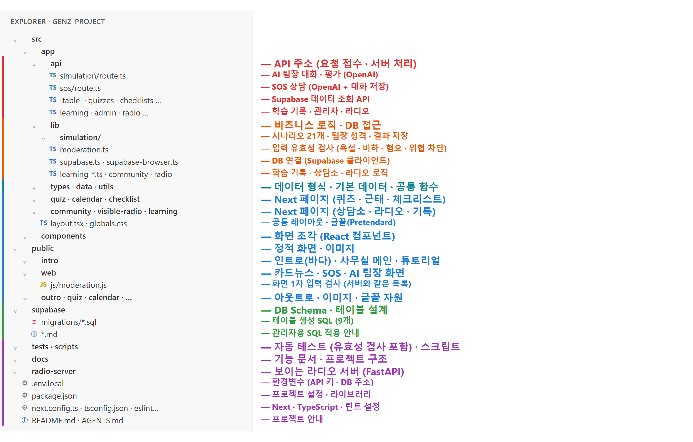

# 젠지표류기 프로젝트 구조

Next.js(App Router) 프로젝트라서 폴더 위치가 곧 주소입니다. `src/app/api/…/route.ts` 는 `/api/…` 서버 API, `src/app/…/page.tsx` 는 페이지, `public/…` 은 그대로 내려가는 정적 파일입니다. 그래서 파일은 옮기지 않고, 역할별로 아래처럼 나눠 봅니다.

| 구분 | 위치 | 하는 일 |
| --- | --- | --- |
| **backEnd · 요청 접수 (API 주소)** | `src/app/api/` | 화면의 요청을 받아 처리하고 결과를 돌려줌 |
| | `api/simulation/route.ts` | AI 팀장 대화 · 평가 (OpenAI 호출, 서명 세션) |
| | `api/sos/route.ts` | SOS 상담 (OpenAI 호출 + 대화 저장) |
| | `api/[table]`, `quizzes`, `checklists`, `checklist-topics` | Supabase 데이터 조회 |
| | `api/learning`, `api/admin`, `api/radio`, `public-config`, `tracking-config` | 학습 기록 · 관리자 · 라디오 · 공개 설정값 |
| **backEnd · 비즈니스 로직 / DB 접근** | `src/lib/` | API 가 쓰는 실제 처리 |
| | `lib/simulation/` | 시나리오 21개, 팀장 성격, 결과 저장 |
| | `lib/moderation.ts` | 입력 유효성 검사: 욕설 · 비하 · 혐오 · 위협 · 성적 표현 차단 (SOS · AI 팀장 서버, 고민상담소 쓰기 창) |
| | `lib/supabase.ts`, `supabase-browser.ts`, `calendar-supabase.ts` | DB 연결 (Supabase 클라이언트) |
| | `lib/learning-*.ts`, `part-feedback-server.ts`, `community/`, `radio/`, `pdf-checklists.ts` | 학습 기록 · 상담소 저장 · 라디오 사연 선정 · PDF 미션 |
| **데이터 형식 · 공통** | `src/types/`, `src/data/`, `src/utils/` | 타입 정의 · 기본 포스트잇 데이터 · 효과음 등 공통 함수 |
| **frontEnd · Next 페이지** | `src/app/quiz`, `calendar`, `checklist`, `community`, `visible-radio`, `learning`, `admin` | 퀴즈 · 근태 가이드 · 체크리스트 · 고민상담소 · 보이는 라디오 · 학습 기록 |
| | `src/app/layout.tsx`, `globals.css` | 공통 레이아웃 · 글꼴(Pretendard) |
| | `src/components/` | 화면 조각 (고민상담소 · 라디오 컴포넌트) |
| **frontEnd · 정적 화면** | `public/intro/` | 인트로(바다) · 사무실 메인 · 튜토리얼 · 나가기 |
| | `public/web/` | 카드뉴스 · SOS 채팅 · AI 팀장 시뮬레이션 화면 |
| | `public/web/js/moderation.js` | 화면 1차 입력 검사 (서버 `lib/moderation.ts` 와 같은 목록 — 함께 고칠 것) |
| | `public/outro`, `quiz`, `calendar`, `checklist`, `radio`, `fonts`, `vendor`, `tracking` | 아웃트로 · 이미지 · 글꼴 · 라이브러리 · 학습 추적 |
| **DB Schema · 테이블 설계** | `supabase/migrations/*.sql` | 테이블 생성 SQL (체크리스트 · 퀴즈 · 학습 기록 · 개인 체크리스트 · AI 팀장 결과) |
| | `supabase/*.md`, `*.sql` | 관리자용 SQL 적용 안내 · 시드 데이터 |
| **테스트 · 스크립트 · 문서** | `tests/`, `scripts/`, `docs/` | 자동 테스트(`moderation.test.cjs`: 두 목록 일치 · 차단 · 오탐 확인 포함) · 데이터 확인 스크립트 · 기능 문서 |
| **별도 서버** | `radio-server/` | 보이는 라디오 서버 (FastAPI) |
| **Project Config · 프로젝트 설정** | `.env.local` | 환경변수 (OpenAI 키 · Supabase 주소 · 서버 키) — 깃에 올리지 않음 |
| | `package.json`, `package-lock.json` | 프로젝트 설정 · 라이브러리 |
| | `next.config.ts`, `tsconfig.json`, `eslint.config.mjs`, `postcss.config.mjs` | Next · TypeScript · 린트 · CSS 설정 |
| | `README.md`, `AGENTS.md`, `CLAUDE.md`, `AI_SIMULATION.md` | 프로젝트 안내 |

## book-library 예시와 비교

| book-library (FastAPI) | 젠지표류기 (Next.js) |
| --- | --- |
| `app/main.py` 시작점 | `src/app/layout.tsx` (페이지) · `public/intro/index.html` (첫 화면) |
| `app/routers/` 요청 접수 | `src/app/api/**/route.ts` |
| `app/services/` 비즈니스 로직 | `src/lib/` |
| `app/repositories/`, `database.py` DB 접근 · 연결 | `src/lib/supabase*.ts` 등 Supabase 클라이언트 |
| `app/schemas.py` 데이터 형식 검증 | `src/types/` + API 안의 입력 검사 · `src/lib/moderation.ts`(욕설 차단) · OpenAI JSON Schema |
| `app/config.py`, `.env` 환경변수 | `.env.local` (Next 가 자동으로 읽음) |
| `app/kakao.py` 외부 API 연동 | OpenAI 호출 (`api/simulation`, `api/sos`) |
| `app/utils.py` 공통 함수 | `src/utils/`, `public/web/js/components/util.js` |
| `sql/schema.sql` 테이블 생성 | `supabase/migrations/*.sql` |
| `static/` 프론트엔드 | `public/` + `src/app/**/page.tsx` + `src/components/` |
| `requirements.txt` | `package.json` |
